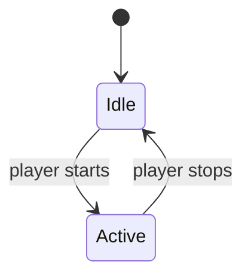

# Design spec: <system>

One page for one system. Path: `reference/design-<system>.md`. The system must serve a pillar of the approved brief.

## System
<what the system is and what the player does with it, in plain words>

## Pillar served
<the pillar's name from the game brief, and one line on how this system serves it>

## Rules
1. <a rule stated so it can be tested: what happens, when, and to what>

## Numbers
| Number | Value | Unit | Source |
|---|---|---|---|
| <name> | <value> | <unit> | <where it came from: playtest, reference game, estimate, or: no source> |

Mark a number without a source `no source`.

## Edge cases
- <an unusual situation, such as a tie, a zero, a maximum or two events at once> - <what the system does>

## Diagrams, tables and mockups
Optional. Include only what the rules cannot say plainly.

A flow or state diagram, kept as a Mermaid block:

Balance data: <link to the numbers file, and its row structure: the columns and which column is the key>

Mockup or blockout: <link to a mockup or blockout kept outside the wiki; never embed a binary here>. Must stay fixed: <one line naming what must not change in it: dimensions, values or states>

## Dependencies
- <another system, asset or tool this spec relies on, or: none>

## Acceptance evidence expected
- <what a reviewer will observe to accept the system: a capture, a test result or a playtest note>

## Fit ruling
<empty until game-master gives it, as fits, does-not-fit or needs-pillar-change, with a date and their reason. An agent never fills this line.>
